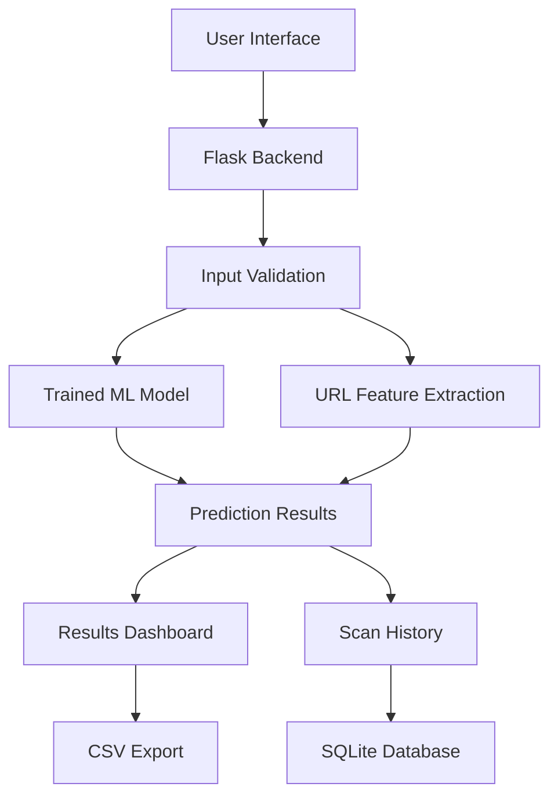

# PhishLens — Machine Learning-Based Phishing URL Detection

PhishLens is a web-based cybersecurity application that uses machine learning to analyze URLs and identify potential phishing threats. It provides an interactive interface for individual and bulk URL analysis, risk assessment, hostname comparison, scan history, and downloadable reports.

The project combines a Python-based machine learning model with a Flask backend and a responsive frontend to make phishing URL analysis accessible and easy to understand.

**Live Demo:** https://phishlens-rebuild.onrender.com/

**Repository:** https://github.com/Mane-Harshad/PhishLens_Rebuild

---

## Key Features

- **Single URL Analysis:** Analyze an individual URL and view its predicted classification.
- **Bulk URL Scanning:** Submit multiple URLs for batch analysis.
- **Phishing Risk Assessment:** View the model's phishing score when supported by the model.
- **Hostname Comparison:** Compare hostnames to help identify potentially deceptive or lookalike domains.
- **URL Characteristics:** Inspect relevant URL properties, including HTTPS usage, IP-address hosts, URL shorteners, suspicious keywords, query parameters, fragments, URL length, and subdomains.
- **Scan History:** Review previously recorded scans.
- **CSV Export:** Export scan results for further analysis and reporting.
- **Light and Dark Themes:** Switch between visual themes for a more comfortable experience.
- **Input Validation:** Reject malformed or incomplete URLs before analysis.
- **Cloud Deployment:** Access the application through its deployed web interface.

## How It Works

PhishLens follows a straightforward analysis pipeline:

1. **Input:** The user submits one URL or a batch of URLs.
2. **Validation:** The application checks whether the supplied URL has a valid structure and hostname.
3. **Model Inference:** The URL is processed by the trained machine learning model to predict whether it is potentially phishing or legitimate.
4. **Feature Inspection:** Relevant URL characteristics are extracted to help users understand properties of the submitted address.
5. **Results:** The application displays predictions and the available phishing-risk score.
6. **History and Export:** Scan results can be reviewed through scan history and exported as a CSV file.

The application analyzes the submitted URL string. It does not need to visit the destination website to perform its model-based classification.

## Technology Stack

| Component | Technologies |
|---|---|
| Backend | Python, Flask |
| Machine Learning | Scikit-learn-compatible model, Joblib |
| Data Processing | Pandas |
| Frontend | HTML5, CSS3, JavaScript |
| URL Analysis | Python URL parsing and custom feature extraction |
| Scan History | SQLite |
| Production Server | Gunicorn |
| Deployment | Render |

## Project Architecture



## Repository Structure

```text
PhishLens_Rebuild/
├── backend/
│   └── app.py
├── frontend/
│   ├── index.html
│   ├── css/
│   │   └── style.css
│   └── js/
│       └── app.js
├── models/
│   └── phishlens_strict_hostname_comp_augmented.joblib
├── src/
│   └── url_features.py
├── results/
│   └── phishlens_history.db
├── requirements.txt
└── .gitignore
```

The `results/` directory and SQLite database may be created at runtime and might not be tracked in Git. Local environment files and virtual environments should remain excluded from version control.

## Getting Started

### Prerequisites

- Python 3.10 or a compatible version supported by the project's dependencies.
- Git.
- A modern web browser.

### 1. Clone the Repository

```bash
git clone https://github.com/Mane-Harshad/PhishLens_Rebuild.git
cd PhishLens_Rebuild
```

### 2. Create a Virtual Environment

**Windows:**

```bash
python -m venv .venv
.venv\Scripts\activate
```

**macOS/Linux:**

```bash
python3 -m venv .venv
source .venv/bin/activate
```

### 3. Install Dependencies

```bash
python -m pip install --upgrade pip
pip install -r requirements.txt
```

### 4. Run the Application

From the repository root, start the Flask application using the Flask CLI:

```bash
python -m flask --app backend.app run --debug
```

Open the local address shown in the terminal. If your local configuration uses a different startup command, follow the entry point and instructions defined in the repository.

**Note:** Ensure that the trained model artifact is present at the expected path under `models/` before starting the application.

## Deployment

PhishLens is deployed on Render. The production configuration installs the Python dependencies and starts the Flask application using Gunicorn.

**Build command:**

```bash
pip install -r requirements.txt
```

**Start command:**

```bash
gunicorn --chdir backend app:app --bind 0.0.0.0:$PORT
```

The application provides a health endpoint at `/api/health` for checking backend and model-loading status.

**Live application:** https://phishlens-rebuild.onrender.com/

### Storage Considerations

The application uses SQLite for scan history. On Render's standard ephemeral filesystem, locally stored database changes may not survive service restarts or redeployments. Persistent history requires a persistent disk or a suitable external database configuration.

## Machine Learning Approach

PhishLens uses a trained machine learning model to classify submitted URL strings. The model and its associated vectorizer are loaded from a serialized Joblib artifact.

The application also extracts URL characteristics to provide additional context about a submitted address.

Important distinctions:

- The predicted class represents the model's classification, not a guarantee of safety or maliciousness.
- A displayed phishing score is a model-derived estimate and should not automatically be interpreted as a calibrated probability.
- URL characteristics provide supporting context; they do not independently establish that a website is malicious.
- The model's predictions depend on its training data and may not recognize every new or evolving phishing technique.

## Limitations

- PhishLens performs URL-based analysis and does not constitute a complete website security inspection.
- It does not guarantee detection of every phishing URL or prevent users from visiting malicious websites.
- Legitimate URLs may be incorrectly flagged, and malicious URLs may be classified as legitimate.
- A URL that appears legitimate based on its structure may still lead to harmful content.
- Model performance can change as phishing techniques evolve; ongoing evaluation and retraining may be necessary.

**Security reminder:** Do not rely solely on an automated classification when deciding whether a URL is safe. Verify suspicious links through trusted sources and avoid entering sensitive information on untrusted websites.

## Future Improvements

Potential enhancements include:

- Periodic model retraining using updated and carefully validated datasets.
- More comprehensive model evaluation and explainability.
- Improved detection of visually deceptive and newly registered domains.
- Persistent cloud storage for scan history.
- Enhanced reporting and monitoring features.
- Additional testing against previously unseen phishing URLs.

## Author

**Harshad Mane**

GitHub: https://github.com/Mane-Harshad

## Disclaimer

PhishLens is an educational and defensive cybersecurity project intended to support phishing awareness and URL analysis. Its predictions are informational and should not be treated as a guarantee of website safety.

---

*Built to explore practical applications of machine learning in cybersecurity.*
